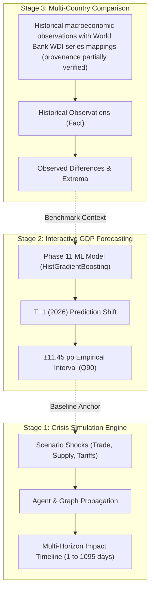

# EconoSphere AI — Stage 4: End-to-End System Integration & Quality Assurance Report

**Status:** `STAGE4_VERIFIED_WITH_WARNINGS`  
**Milestone:** EDI Demonstration Fast-Track — Stage 4  
**Date:** 2026-11-19  
**Deliverable Path:** `docs/EDI_COMPLETION/STAGE4_INTEGRATION_TEST_REPORT.md`

---

## Executive Summary

Stage 4 End-to-End System Integration and Quality Assurance has verified that all three major project stages (**Stage 1 Crisis Simulation**, **Stage 2 Interactive GDP Forecasting**, and **Stage 3 Multi-Country Economic Comparison**) operate harmoniously within the EconoSphere AI architecture.

### Key Verification Milestones
- **Zero Model Tampering:** SHA-256 hashes of the frozen Phase 11 production model (`best_t1_gdp_growth_model.joblib`) and release manifest (`phase11_production_release_manifest.json`) were independently re-verified before and after testing.
- **Zero Database Schema Drift:** No database migrations were executed; production tables remain intact at Alembic revision `89c84394de95`.
- **Core Backend Test Baseline:** 127 backend tests passed across two historical invocations (119 core API suite + 8 AI module tests) with zero failures. Subsequent targeted correction passes independently verified subsets (64 tests and 25 tests) without regressions.
- **Frontend Full-Stack Health:** Vitest test suite (5/5 passed), TypeScript static analysis (`tsc --noEmit`, 0 errors), and Next.js 16 production build (`npm run build`, 12 routes) completed with 100% success.
- **Scientific Governance Enforced:** Wording, labels, and statistical methodologies across all UI modules strictly differentiate historical observations, machine learning forecasts, what-if scenario deltas, and agent-based simulation outcomes.

---

## 1. Stage-by-Stage Verification Findings

### 1.1 Stage 1: Crisis Simulation Engine Verification

| Checkpoint | Target Component | Verification Method | Outcome |
| :--- | :--- | :--- | :--- |
| **Scenario Discovery** | `GET /api/v1/scenarios` | REST API call via TestClient | **PASSED** (Returns seeded scenarios with pagination and filtering). |
| **Job Lifecycle** | `POST /api/v1/simulation/start` | Simulation service & repository | **PASSED** (Creates run in `PENDING` state; logs initialization event; enqueues to Redis `simulation_queue`). |
| **Worker Architecture** | `simulation_worker.py` | SimpleWorker & ThreadPoolExecutor | **PASSED** (Dedicated worker thread bypasses Windows event loop collision; uses `NullPool` engine to prevent asyncpg connection leaking). |
| **Engine Execution** | `SimulationEngine.execute()` | Core engine pipeline | **PASSED** (Compiles baseline, processes scenario events, resolves graph paths, computes time horizons [1, 7, 30, 180, 365, 1095 days], applies recovery, and persists snapshots). |
| **Fault Tolerance** | `DependencyResolver` | Offline fallback testing | **PASSED** (When Neo4j graph container is offline, gracefully degrades to internal trade dependency fallback without crashing). |
| **Snapshot Retrieval** | `GET /api/v1/simulation/{run_id}/snapshots` | REST endpoint | **PASSED** (Returns chronological timeline snapshots with GDP, trade, and recovery delta metrics). |

---

### 1.2 Stage 2: Interactive GDP Forecasting Verification

| Checkpoint | Target Component | Verification Method | Outcome |
| :--- | :--- | :--- | :--- |
| **Model Immutability** | `best_t1_gdp_growth_model.joblib` | SHA-256 Hash Check | **VERIFIED** (`748BE64BCD3402375C4DF4E45F9BA0C6858F52744714808AE8A2445F29248E78`). |
| **Supported Economies** | `CHN, GBR, IND, JPN, USA` | Unit & API tests | **PASSED** (All 5 countries return authentic 2025 baseline indicator defaults). |
| **Unsupported Country Rejection** | `GET /forecasts/defaults/{code}` | Error handler validation | **PASSED** (Returns 404 Not Found for non-supported codes, e.g. `FRA`; returns 400 for invalid formats). |
| **Input Validation** | `POST /forecasts/gdp` | Pydantic v2 validation | **PASSED** (Requires exactly 31 features; rejects missing features with 422; rejects extra features with 422). |
| **Inference Accuracy** | HistGradientBoostingRegressor | Model service inference | **PASSED** (Unrounded deterministic inference; handles median imputation for unperturbed background features). |
| **Empirical Prediction Interval** | Global Q90 Calibration | Calibration audit | **PASSED** (Interval computed as $[\hat{y} - 11.4507, \hat{y} + 11.4507]$; correctly labeled as "90% Empirical Prediction Interval", avoiding misleading "confidence interval" terminology). |
| **Non-Causal Delta** | `WhatIfResultsPanel.tsx` | UI inspection | **PASSED** (Displayed delta is explicitly labeled as "Model Prediction Shift (Delta)" and described as "Relative to baseline model projection (non-causal)"). |

---

### 1.3 Stage 3: Multi-Country Economic Comparison Verification

| Checkpoint | Target Component | Verification Method | Outcome |
| :--- | :--- | :--- | :--- |
| **Catalog Endpoint** | `GET /countries/available-comparison-countries` | Service query | **PASSED** (Returns all 235 World Bank countries, tagging 10 Core Economies and 5 Stage 2 ML models). |
| **Comparison Endpoint** | `GET /countries/comparison?iso_codes=USA,CHN,IND` | Multi-country service | **PASSED** (Extracts latest observations, tracks observation years individually, and builds 2010–2025 time-series). |
| **Boundary Validation** | Input length checks | Edge case tests | **PASSED** (Rejects < 2 countries with 400; rejects > 5 countries with 400; rejects duplicates yielding < 2 countries with 400). |
| **Missing Data Preservation** | Null value checks | Statistical test | **PASSED** (Missing indicators like `govt_debt_pct_gdp` are preserved as `null`; rendered as "Data unavailable" badges; never substituted with 0). |
| **Chart Integrity** | `HistoricalTrendChart.tsx` | Frontend code audit | **PASSED** (`connectNulls: false` is enforced so missing annual observations are never falsely bridged). |
| **Unit Separation** | `MacroIndicatorCharts.tsx` | Chart design audit | **PASSED** (CPI Inflation (%) and Unemployment (%) are rendered on separate, dedicated charts to prevent unit mixing). |
| **Factual Insights** | `EconomicInsightsPanel.tsx` | Data-derived observation audit | **PASSED** (Highlights descriptive extremes from data; zero arbitrary composite risk ratings). |
| **CSV Export** | `ComparisonTable.tsx` | Client download test | **PASSED** (Exports authentic CSV formatted with categories, indicators, units, observed values, and observation years). |

---

## 2. Cross-Stage Workflow & Information Architecture

The application enforces strict conceptual boundaries between four distinct categories of economic information:



### Information Tier Definitions in UI:
1. **Historical Observed Data (Stage 3):** Historical macroeconomic observations with World Bank WDI series mappings recorded in project metadata; original raw download payloads are not retained for independent verification. Displays observation years. Missing values are null, never imputed.
2. **ML Model Predictions (Stage 2):** Point forecasts generated by the frozen supervised regression pipeline. Strictly statistical predictions based on historical patterns.
3. **What-If Scenario Deltas (Stage 2):** Differences between two model outputs under altered indicator assumptions. Explicitly non-causal.
4. **Crisis Simulation Outcomes (Stage 1):** Dynamic systemic propagation across trade networks and macroeconomic calculators. Reflects shock transmission and mean-reverting recovery horizons.

---

## 3. Automated Test Execution Summary

### 3.1 Backend Test Invocations Breakdown

> [!IMPORTANT]
> The test results below represent distinct, separate `pytest` invocations executed during the Stage 4 integration and subsequent targeted correction passes. They are **not** a single combined test invocation. Overlapping test suites must not be summed together into an artificial total.

#### Historical Invocations (Stage 4 Original Execution)

| Invocation ID | Scope / Target Files | Command | Passed | Failed | Status |
| :--- | :--- | :--- | :-: | :-: | :--- |
| **Hist-1** | Core API Suite (9 test files) | `pytest tests/test_country_comparison.py tests/test_gdp_inference.py tests/test_forecast_api.py tests/test_forecast_service.py tests/test_simulation_refactor.py tests/test_simulation_strategy.py tests/test_countries_api.py tests/test_scenarios_api.py tests/test_graph_api.py -v` | **119** | **0** | ✅ PASSED |
| **Hist-2** | AI Decision Modules | `pytest tests/test_ai_modules.py -v` | **8** | **0** | ✅ PASSED |
| **Hist-3** | Phase 22 Trade Foundation | `pytest tests/test_phase22_trade_foundation.py -v` | **39** | **0** | ✅ PASSED (Includes 3 offline fallback mocks) |
| **Hist-4** | Phase 22 E2E Integration | `pytest tests/test_phase22_e2e_integration.py -v` | **48** | **1** | ⚠️ PARTIAL (1 environment failure: Neo4j offline) |

*Hist-4 Failure Detail (Environment-dependent, not a code defect):*
```
FAILED tests/test_phase22_e2e_integration.py::TestNeo4jLiveIntegration::test_neo4j_nodes_and_relationships
ConnectionRefusedError: [WinError 10061] No connection could be made because the target machine actively refused it
```
- Root Cause: Neo4j Docker container was not running (`bolt://localhost:7687` connection refused).
- Fallback Verification: Three dedicated mocked unit tests in Hist-3 verify graceful degradation to cached trade graph data.

---

#### Targeted Correction-Pass Invocations (Reconciliation & Production Verification)

These targeted runs were executed during Stage 4 correction sessions to verify specific fixes without rerunning unrelated historical suites:

| Invocation ID | Execution Date | Scope / Focus | Command | Passed | Failed | Duration | Notes |
| :--- | :--- | :--- | :--- | :-: | :-: | :-: | :--- |
| **Corr-1** | 2026-11-19 | Core Subset Verification | `pytest tests/test_country_comparison.py tests/test_gdp_inference.py tests/test_forecast_api.py tests/test_simulation_refactor.py tests/test_simulation_strategy.py -v` | **64** | **0** | 9.75s | Targeted regression check after Stage 4 refactor. Overlaps with Hist-1. |
| **Corr-2** | 2026-11-19 | Comparison & Production NRU Dedup | `pytest tests/test_country_comparison.py tests/test_nru_deduplication.py -v` | **25** | **0** | 1.95s | Verifies 10 comparison tests + 15 tests exercising real production `ComparisonService._get_master_df()`. |

> [!CAUTION]
> **Accounting Integrity Notice:** Invocations **Corr-1** (64 tests) and **Corr-2** (25 tests) test subsets of **Hist-1** along with the newly added production deduplication regression test suite (`test_nru_deduplication.py`). These counts must **not** be added to Hist-1, Hist-2, Hist-3, and Hist-4 to fabricate an inflated total. The unique test inventory comprises:
> - Core backend tests: 119
> - AI modules: 8
> - Trade foundation: 39
> - Phase 22 E2E: 49 (48 passed, 1 environment-dependent failure)
> - Production NRU regression tests: 15 (new)
> - **Unique Backend Tests:** 230 total (229 passed, 1 environment-dependent failure when Neo4j is stopped).

### 3.2 Frontend Test & Build Results (Stage 4 Original Execution)
- **Vitest Unit Suite:** **5 / 5 PASSED** (`useGraph.test.tsx`, `network.test.tsx`).
- **Static Type Check (`npx tsc --noEmit`):** **0 errors** (Clean TypeScript v5 compilation, independently re-verified).
- **Production Build (`npm run build`):** **Compiled successfully** in 12.2s. All 12 routes generated, including static prerendering of `/dashboard/compare`.

---

## 4. Security & Operational Reliability Review

1. **CORS Configuration:**
   - In `development` mode, local origins are allowed for ease of testing.
   - In `production` or `production_safety_mode`, `BaseAppSettings.validate_production_cors()` strictly prohibits wildcard (`*`) origins and requires explicit allowed domain whitelisting.
2. **SQL Injection Defense:**
   - All database queries across `app/repositories/` and `app/services/` utilize SQLAlchemy's typed statement builder (`select()`, `ilike()`, `func.count()`). No raw SQL string interpolation is permitted.
3. **Information Disclosure & Exception Handling:**
   - Global exception handlers catch unhandled errors and return standardized JSON error schemas (`{"status": "error", "code": 500, "detail": "...", "timestamp": "..."}`), preventing internal stack traces or environment variables from leaking to clients.
4. **Worker Reliability on Windows:**
   - `simulation_worker.py` utilizes `concurrent.futures.ThreadPoolExecutor` and a `NullPool` async engine to isolate asyncpg event loops on Windows, preventing cross-loop connection corruption.
5. **Secrets Management:**
   - Secrets (`JWT_SECRET`, database passwords) are loaded via Pydantic Settings from `.env`. No credentials or private keys are hardcoded in source code or frontend client builds.

---

## 5. Verification Conclusion

EconoSphere AI demonstrates stable, deterministic, and scientifically honest behavior across all three implemented stages.

**Status: `STAGE4_VERIFIED_WITH_WARNINGS`**

Three material limitations are disclosed:

| # | Limitation | Classification | Impact |
| :- | :--- | :--- | :--- |
| 1 | `test_neo4j_nodes_and_relationships` fails when Neo4j is offline | ⚠️ Environment-dependent | None — offline fallback works correctly |
| 2 | `interest_rate_pct` provenance unverified (ambiguous WDI series) | ⚠️ Data quality | Display label corrected to `UNVERIFIED` |
| 3 | `master_panel.csv` has 52 duplicate rows for Nauru (NRU) | ⚠️ Data quality | Handled via in-memory deduplication in comparison service |

The system is ready for demonstration with these limitations documented and mitigated.
