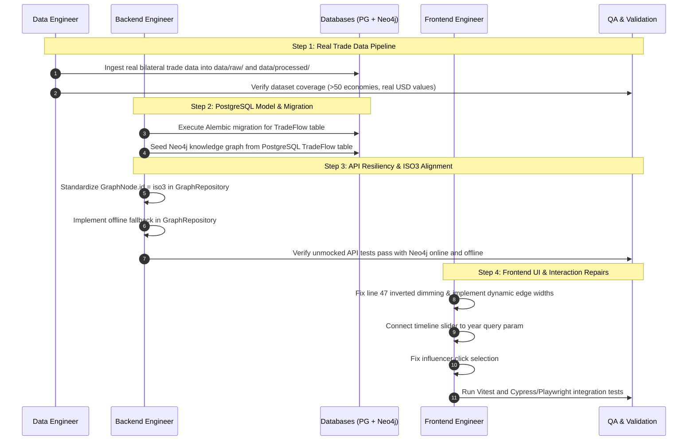

# Phase 22 Readiness Assessment & Implementation Scope

**Project:** EconoSphere AI — Global Economic Crisis Simulator  
**Audit Phase:** Pre-Phase 22  
**Target Phase:** Phase 22 (Global Trade Intelligence Foundation & Real-Data Integration)  
**Date:** October 15, 2026  

---

## 1. Readiness Assessment & Final Strategic Verdict

### Strategic Verdict: `PHASE22_REQUIRES_FOUNDATION_REPAIRS`

The existing Trade Network module **does not require a total rewrite from scratch**, nor is it ready for immediate feature additions. The visual layout shell, styling, component structure, FastAPI routing, and Cytoscape integration are well-structured and reusable. However, the system cannot support advanced shock simulations or policy decisions because its foundational data layer and network identifier mappings are broken.

Phase 22 must be a **tightly scoped foundation repair and real-data integration phase**.

---

## 2. Reusable Assets Inventory (Avoiding Unnecessary Rewrites)

To maximize development velocity and preserve valuable architectural work, Phase 22 should reuse the following components:

1. **Frontend Layout Shell (`TradeNetworkPage.tsx`):**
   - Header bar, search input, filter buttons, KPI card grid, and layout responsiveness are clean and reusable.
2. **Cytoscape Canvas Wrapper (`TradeGraph.tsx`):**
   - Theme integration (dark/light), canvas mount, node coloring by entity type, and event taps are reusable once the line 47 dimming bug and line 113 static width are fixed.
3. **State & UI Feedback Components:**
   - `<EmptyState>` and `<ErrorState>` are fully tested and ready.
4. **FastAPI Endpoints & Routers (`graph.py`, `router.py`):**
   - Endpoint paths (`/network`, `/centrality`, `/neighbors`, `/path`) and Pydantic schemas (`GraphNode`, `GraphEdge`, `GraphResponse`) are structurally sound.
5. **Trade Strategy Math (`apps/api/app/engine/strategies/trade.py`):**
   - The deterministic propagation formula `secondary_shock = primary * weight * (1 - decay)` and cycle prevention logic are rigorous and pass unit tests.

---

## 3. Strict Scope Separation for Phase 22

### 3.1 Must Have (Phase 22 Core Scope)

#### 1. Real Bilateral Trade Data ETL Pipeline
- **Specification:** Create an automated, reproducible, credential-free ingestion script (`apps/api/ml/scripts/download/ingest_real_trade.py`) downloading authentic bilateral trade flows for the top 50 global economies (covering >85% of world GDP) from authentic public sources (e.g. UN Comtrade free API / World Bank WITS / CEPII BACI open datasets).
- **Target Storage:** Store raw immutable JSON in `data/raw/trade/` and processed tabular parquet/CSV in `data/processed/trade_flows.csv`.

#### 2. PostgreSQL Relational Trade Ledger
- **Specification:** Create Alembic migration and SQLAlchemy model `TradeFlow` in `apps/api/app/models/trade.py` with columns:
  - `id` (BigInteger PK)
  - `source_iso3` (String 3, indexed)
  - `target_iso3` (String 3, indexed)
  - `year` (Integer, indexed)
  - `commodity_category` (String 50)
  - `export_value_usd` (Float)
  - `import_value_usd` (Float)
  - `created_at` (Timestamp)

#### 3. Real Neo4j Knowledge Graph Seeder & Offline Cache
- **Specification:** Update Neo4j seeder (`seed_neo4j_trade.py`) to populate nodes and edges directly from the verified PostgreSQL `TradeFlow` table rather than random numbers.
- **Offline Resilience:** If Neo4j is unreachable, `GraphRepository` must seamlessly fallback to querying the PostgreSQL `TradeFlow` table or an in-memory JSON snapshot (`data/processed/cached_network.json`), guaranteeing zero HTTP 500 crashes.

#### 4. Sovereign ISO3 Identifier Standardization
- **Specification:** Standardize `GraphNode.id` across all backend responses to use sovereign `iso3` (e.g., `"USA"`), eliminating the internal database element ID mismatch (`"4:624f21a6-..."`).
- **Impact:** Instantly restores functionality to top influencer clicks and neighbor selection.

#### 5. Frontend Visual & Interaction Repairs
- **Specification:**
  - Fix inverted dimming logic in `TradeGraph.tsx` line 47.
  - Implement volume-scaled edge thickness (`width: mapData(tradeVolume, ...)`).
  - Connect the timeline replay slider to fetch year-filtered network data (`/api/v1/graph/network?year=YYYY`).
  - Eliminate hardcoded fallback strings (`'$14.2T (Est)'`, `'28%'`, static influencers).
  - Format partner trade volumes with dynamic currency notation (`$B` / `$M`).
  - Wire up bilateral trade balance metric (Exports minus Imports).

---

### 3.2 Should Have (Phase 22 Secondary Scope, Time Permitting)
1. **Interactive Pathfinding Modal:** Wire the existing backend endpoint `/api/v1/graph/path` to a frontend modal allowing users to select Source and Target countries and visualize supply-chain hops.
2. **Deterministic Layout Coordinates:** Precompute or cache 2D force-directed node coordinates to prevent Cytoscape layout re-randomization on every filter click.
3. **Region Multi-Select Dropdown:** Allow filtering the graph by geographic regions (e.g., East Asia, Europe, North America).

---

### 3.3 Future Phase (Explicitly Excluded from Phase 22)
1. **Crisis Shock Propagation Execution:** Multi-hop live contagion simulations belong in Phase 23+.
2. **Generative AI Policy Explanations:** LLM-generated trade mitigation belongs in Phase 24+.
3. **Dynamic Tariff Elasticity Modeling:** High-frequency econometric tariff simulation belongs in Phase 25+.

---

## 4. Phase 22 Implementation Sequence & Acceptance Criteria

### Detailed Acceptance Criteria

1. **Criterion 1 (Data Provenance):**
   - `data/processed/trade_flows.csv` contains verified bilateral trade data from an authentic public agency.
   - Zero random number generators exist in trade seeding scripts.
2. **Criterion 2 (Fault Tolerance):**
   - With Neo4j running, `GET /api/v1/graph/network` returns HTTP 200 with real nodes and edges.
   - With Neo4j stopped, `GET /api/v1/graph/network` returns HTTP 200 with cached/fallback trade data (never HTTP 500).
3. **Criterion 3 (Visual Presentation):**
   - On initial dashboard load, network edges are visible at standard opacity (`0.6`), not dimmed to `0.1`.
   - Major trade corridors (e.g. USA-CHN, USA-CAN, DEU-FRA) render with visibly thicker lines than minor corridors.
4. **Criterion 4 (User Interaction):**
   - Clicking any country in "Top Network Influencers" immediately highlights that country on the canvas and opens the node details sidebar.
   - Moving the timeline slider updates the graph with trade data from the selected year.
5. **Criterion 5 (Integrity Preservation):**
   - All Phase 11 protected artifacts (`best_t1_gdp_growth_model.joblib`, `phase11_production_release_manifest.json`, `master_panel_t1_missingness.csv`) retain their exact cryptographic hashes.
