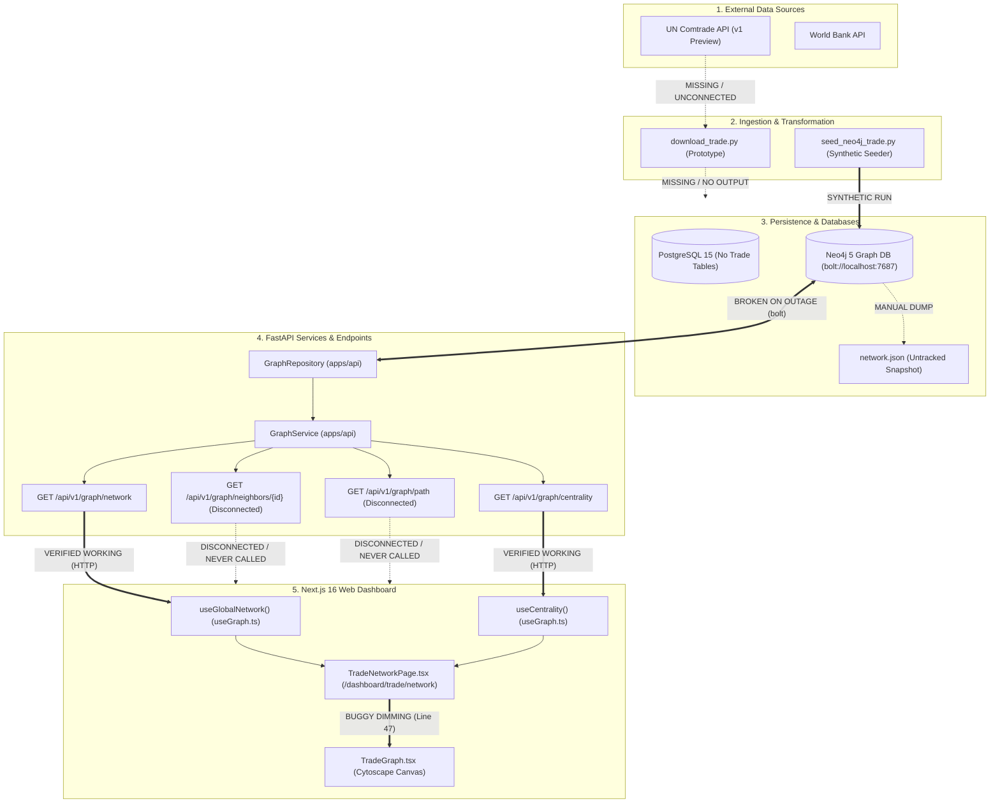

# Trade Network Architecture & Data Flow Audit Report

**Audit Target:** End-to-End System Architecture  
**Audit Scope:** Ingestion -> Processing -> Storage -> API -> Frontend Visualization  
**Date:** October 15, 2026  

---

## 1. End-to-End Architecture Connection Map



---

## 2. Connection-by-Connection Audit Classification

| Connection Link | Component Source -> Component Target | Audit Classification | Codebase Evidence & Findings |
|---|---|---|---|
| **C-1** | UN Comtrade API -> `download_trade.py` | **PARTIALLY IMPLEMENTED** | Script exists in `apps/api/ml/scripts/download/download_trade.py`, but has no cron, CLI schedule, or error retry loop. |
| **C-2** | `download_trade.py` -> `data/raw/` storage | **MISSING** | No data artifacts have ever been saved by this script to `data/raw/` or `data/processed/`. Target directory `DEFAULT_RAW_DIR` is nonexistent. |
| **C-3** | `seed_neo4j_trade.py` -> Neo4j Database | **IMPLEMENTED (SYNTHETIC)** | Successfully connects to Neo4j and executes `CREATE (:Country)-[:EXPORTS_TO]->(:Country)`, but seeds 100% synthetic random values. |
| **C-4** | Ingestion -> PostgreSQL Storage | **MISSING** | PostgreSQL has zero models or tables for bilateral trade relationships. Migration `b2c3d4e5f6a7` only added indexes for scenarios. |
| **C-5** | Neo4j Storage -> `GraphRepository` | **BROKEN** | Connects via bolt protocol, but crashes with unhandled `ServiceUnavailable` when Neo4j is offline. Queries lack parameterization for year and commodity. |
| **C-6** | `GraphRepository` -> `GraphService` | **VERIFIED WORKING** | Async methods pass requests and wrap results cleanly. |
| **C-7** | `GraphService` -> `/api/v1/graph/network` | **VERIFIED WORKING** | Returns valid `GraphResponse` schema containing nodes and edges. |
| **C-8** | `GraphService` -> `/api/v1/graph/centrality` | **VERIFIED WORKING** | Returns list of `{ node_id, score }` records based on out-degree count. |
| **C-9** | `GraphService` -> `/api/v1/graph/neighbors` | **IMPLEMENTED BUT UNCONNECTED** | Endpoint functions on backend, but is completely disconnected from frontend hooks. |
| **C-10** | `GraphService` -> `/api/v1/graph/path` | **IMPLEMENTED BUT UNCONNECTED** | Endpoint functions on backend, but is completely disconnected from frontend hooks. |
| **C-11** | `/api/v1/graph/network` -> `useGlobalNetwork` | **VERIFIED WORKING** | TanStack Query hook cleanly queries endpoint with 5-minute stale time. |
| **C-12** | `/api/v1/graph/centrality` -> `useCentrality` | **VERIFIED WORKING** | TanStack Query hook cleanly queries endpoint with 5-minute stale time. |
| **C-13** | `useGraph.ts` -> `TradeNetworkPage.tsx` | **PARTIALLY IMPLEMENTED** | Data loads into page, but influencer node selection fails due to ID mismatch (`element_id` vs `iso3`). |
| **C-14** | `TradeNetworkPage.tsx` -> `TradeGraph.tsx` | **BROKEN** | Inverted dimming logic (line 47) marks all edges as `dimmed: "true"` by default. Edge thickness is hardcoded. |

---

## 3. Core Architectural Vulnerabilities & Design Flaws

### 3.1 Single Point of Failure (SPOF) on Neo4j
- **Problem:** The Trade Network module treats Neo4j as an unbuffered, synchronous dependency. Unlike PostgreSQL or Redis, which are integrated with connection pools and fallback handling, any unavailability of Neo4j immediately causes the entire trade dashboard to crash.
- **Architectural Solution for Phase 22:** Implement a **dual-storage architecture**:
  1. PostgreSQL maintains the primary relational trade ledger (`trade_flows` table: `source_iso3`, `target_iso3`, `year`, `commodity_code`, `trade_value_usd`).
  2. Neo4j acts as an accelerated topological index built and updated from the PostgreSQL ledger.
  3. If Neo4j is offline, the API falls back to a SQL aggregation query or a cached JSON artifact, ensuring 99.9% uptime.

### 3.2 Identifier Mismatch (Internal Element ID vs. Sovereign ISO3)
- **Problem:**
  - `GraphRepository.get_network()` maps:
    ```python
    node_id = str(value.element_id) # e.g. "4:624f21a6-4ee2-4cee-8117-d08e852d7577:18"
    ```
  - `GraphRepository.get_centrality()` maps:
    ```cypher
    RETURN n.iso3 AS node_id, count(r) AS score
    ```
  - `TradeNetworkPage.tsx` expects:
    ```typescript
    graph.nodes.find(n => n.id === country.id) // "4:624..." === "USA" -> ALWAYS FALSE
    ```
- **Architectural Solution for Phase 22:** Standardize `GraphNode.id` across the entire backend and frontend to use the universal sovereign identifier: **ISO 3166-1 alpha-3 code (`iso3`)**. Database element IDs must never be exposed across the public API boundary.

### 3.3 Cytoscape Main-Thread Layout Execution
- **Problem:** The Cytoscape `cose` layout algorithm runs synchronously on the browser's main thread. In `TradeGraph.tsx`, every keystroke in the search box or toggle of a filter button triggers a re-render that re-runs the randomized layout, causing lag and risk of thread lockup.
- **Architectural Solution for Phase 22:**
  - Store deterministic coordinates (e.g., geographical force-directed or precomputed layout coordinates) on node properties (`x, y`).
  - Use `preset` layout when coordinates are available, running dynamic layouts only on user request.
